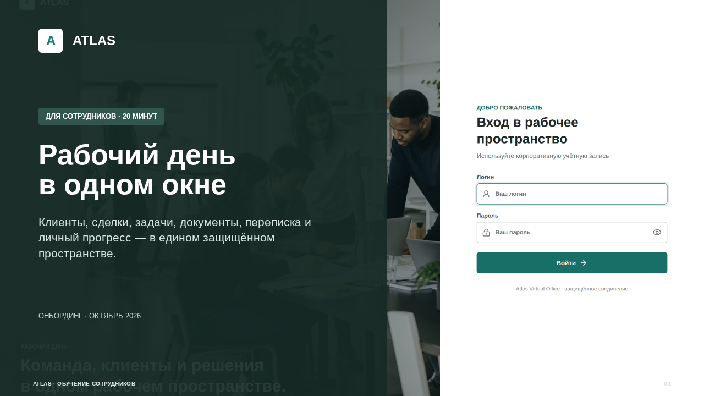

# Онбординг сотрудников Atlas

Готовая русскоязычная презентация для первого знакомства сотрудников с Atlas.
Рекомендуемая продолжительность — 20 минут и короткая практика после показа.
Версия от 11 октября 2026 года: 18 слайдов.

## Файлы

- [PDF](Atlas_Onboarding_Employees_RU.pdf) — версия для просмотра и рассылки.
- [HTML](Atlas_Onboarding_Employees_RU.html) — исходник слайдов, браузерная и печатная версия.
  PDF и превью собираются из него печатью в Chrome (формат 13,333 × 7,5 дюйма).
- [Превью слайдов](rendered/) — изображения для быстрого просмотра.
- [Скриншоты Atlas](screens/) — исходные экраны, использованные в презентации.
- [PowerPoint](Atlas_Onboarding_Employees_RU.pptx) — **устарел**: это версия от августа 2026 года
  (13 слайдов), без досок задач, нескольких воронок, чата, почты, Telegram и обращений.
  Актуальны PDF и HTML.

## Сценарий показа

1. Объяснить роль Atlas в ежедневной работе и пройти по меню.
2. Показать первый вход, смену пароля и границы доступа сотрудника.
3. Пройти маршрут: дашборд → CRM и карточка клиента → воронки → мои задачи и доски → документы.
4. Объяснить KPI, достижения, профиль с AI-анализом, присутствие и политику мониторинга.
5. Показать связь: чат команды, почта, Telegram-переписка с клиентами.
6. Показать «Сообщить о проблеме» (кнопка есть на каждой странице) и что дальше происходит с обращением в разделе «Обращения».
7. Завершить чек-листом и практикой: перевести учебную задачу в «В работе» и написать
   руководителю в «Сообщениях».

Скриншоты рабочих разделов сделаны в демонстрационном режиме под профилем
`Сотрудник` и не содержат производственных данных. Экран входа снят с действующего
развёртывания Atlas. Все денежные суммы показаны в украинских гривнах (`UAH`, `₴`).
Почта и Telegram работают, только когда они настроены на сервере компании
(почтовые провайдеры, ключ шифрования, бот). До этого разделы показывают, что канал
не настроен.

